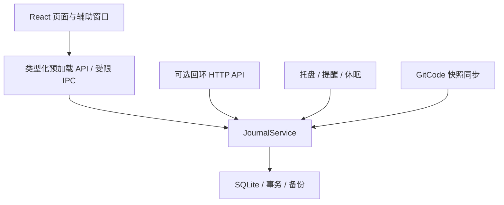

# 架构说明

当前本地交付版本：0.30.0；日志数据结构：19。GitHub 公开版本以 Releases 为准。技术栈为 TypeScript、React、Electron 和 SQLite。

## 责任边界

- `core/` 不依赖 React 或 Electron。`JournalService` 统一执行业务命令、校验和事务保存，成功后才通知界面。
- `src/` 通过快照、轻量时钟读取和命令更新状态；筛选、自动排序、日历布局与交互控制分开维护。
- `electron/` 管理窗口、托盘、系统能力、SQLite 生命周期和同步。预加载只暴露允许的操作，渲染器启用 sandbox、contextIsolation 和 CSP，不直接访问 Node 或任意 IPC。
- 今日、事项、日历、回顾和设置为内置模块；先保持明确接口，再依据使用需要扩展。

## 数据与时间

事项可任意嵌套；项目是标记。笔记和事件共享身份、内容与组织关系，但不强行拥有任务的执行语义。移动保留 ID、历史投入和引用，更新层级路径与汇总。

计划开始、截止、真实开始、真实完成、本次计时和净投入各自独立。原始估计与修订历史保留。没有估计不代表零；估计耗尽不会自动完成任务。

会话包含实际投入片段。暂停、休息不计入投入；跨午夜按片段分摊；多个事项可并行计时，同一事项最多保留一个未结束计时器。累计时间分别相加，另提供去重覆盖时间。

单调时钟计算净投入，系统时间记录发生时刻。每 10 秒保存检查点；显式操作立即落盘。休眠和正常退出暂停计时，异常恢复不推测离线投入。未关联事项的会话保留原 ID，事后关联不复制投入。

SQLite 使用 WAL、FULL 同步和事务，按实体保存 JSON 记录；迁移和恢复前备份。删除投入进入可恢复记录集，恢复前验证重叠，重算事项与父级汇总。

## 责任与记录

事项结束状态、当前责任和完成归属各自独立。交接采用独立 handed-off 关闭状态，排除默认未完成和逾期队列，不算完成或取消。交接保留身份与投入，只有明确选择的子项一起交接；结束计时须确认。跟进提醒覆盖当前有效提醒但保留原提醒，重新接手后恢复原提醒并转为 open，不启动计时。未被选择的子项继续独立执行，不受已交接父项的责任关闭阻止。历史完成归属不推断。

业务活动在 JournalService 成功提交时生成，与修改一起原子保存；时钟刷新、检查点和纯选择不会生成业务活动。活动保存稳定 ID、来源、版本、入口及修改前后差异，进入备份和完整快照同步，导入不会将历史活动重放成新操作。

轻量操作与 AI 使用由主进程 UsageStore 管理，分文件、分脏标志、延迟批量写入，正常退出刷新。操作仅含操作、入口、结果与版本，另有 ID/时间元数据；限制最近 5000 条。AI 最近 200 次，在生成结束、失败或停止时记录请求、范围清单、分析、建议与服务实际用量；应用结果随后更新。详细文本不进入日志备份或同步，清理后不因异步应用重新出现。连接凭据与授权头不进入记录。

## 日期、筛选与排序

日期型截止保存为 `YYYY-MM-DD`，表示严格早于该日期的本地零点；精确截止为 UTC ISO 时间。所有显示、排序和视图边界复用日期规则。

相对日期视图动态计算，周一为一周起点。筛选命中与父级路径分开，父级不计入命中数；最后一个命中子项退出后，不符合条件的祖先消失。已保存视图遵循显式条件，不被全局默认值偷偷重写。

自动同级排序参考今日重点、截止与计划，保留树结构；编辑期间稳定位置，不改写历史和存储的手动顺序。虚拟化只改变渲染范围，键盘焦点与选择使用独立模型。

## 原生辅助窗口

快速记录、到时提醒与屏边计时签使用独立窗口和受限预加载脚本，共享同一个 `JournalService`。它们不创建第二套时钟或重复累计时间。

到点只提醒，直到用户主动结束。声音、持续置顶卡片、稍后提醒和休息继续构成完整循环。屏边计时签在主窗口最小化或隐藏后非抢焦点显示，到时卡片优先；位置与隐藏偏好仅在本机保存。

## 同步与 AI 接口

GitCode 同步将版本化 JSON 快照写入专用分支。比较本地、远端和上次同步快照；双方修改时要求明确选择，再次检查版本后应用，下载覆盖前备份，不强推。令牌用 safeStorage 加密，设备偏好与密钥不进入日志。

HTTP API 默认关闭、默认只读，只绑定回环地址。Bearer 密钥、写入修订号、幂等请求键和命令白名单共同约束调用；拒绝浏览器 Origin，不暴露 SQL、任意 IPC、令牌、任意导入或应用退出。AI 与 UI 使用同一领域服务。同步为可轮询异步操作，冲突选择仍须明确。

## 验证与发布

业务规则和真实组件交互优先自动验证；原生行为用隔离 Electron 配置做短烟测。所有测试输出保存在忽略目录，测试必须正常退出，不影响个人实例。

Windows 包从固定 Electron 运行时和应用构建生成，使用 app.asar，不需要用户安装 Node.js。第三方许可证随包提供。生产包不包含测试入口、数据库或设备配置。发布前核对版本、压缩包 SHA-256 和源文件范围。

## 桌面平台

核心业务与 schema 19 继续共用。core/desktop-platform.ts 定义修饰键和全局记录默认值；src/platform.ts 读取受限预加载提供的平台标识，统一转换 Command 操作和提示。electron/desktop-platform.ts 管理原生窗口配置与菜单；macOS 不调用 Windows 标题栏覆盖 API，使用模板菜单栏图标并响应 Dock activate。

macOS 在原生 arm64 / x64 GitHub runner 分别构建和验证，生产与 QA 分开打包。QA 只改测试入口，不改业务代码；生产包不包含 QA 入口或数据库。ZIP / DMG 验证架构、ad-hoc 签名和归档完整性；目前不包含 Developer ID 签名或 Apple 公证。
